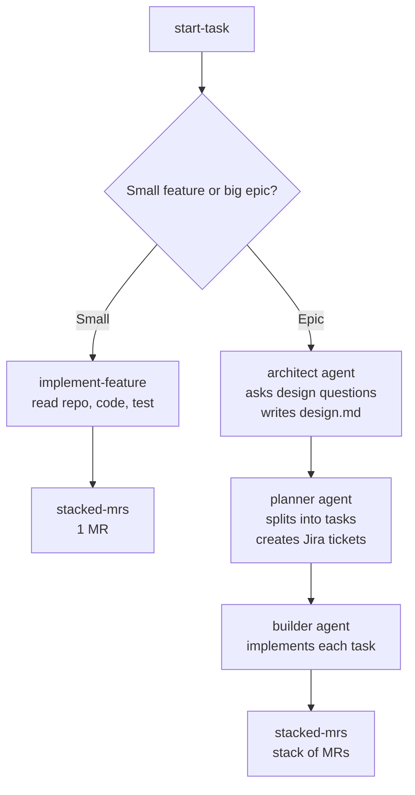

# agent-hub

One place for the team's shared AI **agents** and **skills**. Install them into any
repo with one command, and everyone works the same way.

## The idea in 30 seconds

```bash
apm install rutansh/agent-hub
```

Then tell your coding agent: **"use start-task"**. It asks whether your work is a small
feature or a big epic and does the rest.



## Agents (roles)

| Agent | Does one thing |
| --- | --- |
| `architect` | Interviews you about the design, then writes `design.md` |
| `planner` | Splits the design into small tasks and creates the Jira tickets |
| `builder` | Implements the tasks and opens a stack of merge requests |

## Skills (tasks)

| Skill | Does one thing |
| --- | --- |
| `start-task` | Entry point. Asks small vs epic, then routes the work |
| `implement-feature` | Builds a small feature using the repo's code as context |
| `jira-tickets` | Creates a Jira epic and child tickets |
| `stacked-mrs` | Ships work as a stack of small, dependent merge requests |
| `connect-tools` | Loads credentials from `.env` and checks `gh`, `glab` and `acli` |

### Pharma skills (domain examples)

| Skill | Does one thing |
| --- | --- |
| `summarize-trial` | Turns a clinical trial record into a structured brief |
| `triage-adverse-events` | Prioritizes adverse event reports |
| `review-literature` | Synthesizes provided papers into a cited brief |

## Install

```bash
brew install apm                         # once per machine

apm install rutansh/agent-hub            # everything
apm install rutansh/agent-hub#v0.3.0     # pinned to a release

# only some skills (agents always come with it)
apm install rutansh/agent-hub --skill start-task --skill implement-feature
```

Files land in `.cursor/agents/` and `.agents/skills/`. For other tools, add a target,
for example `--target claude` or `--target copilot`.

Upgrade: change the ref in `apm.yml`, then `apm install --update`.

## Needed for the epic workflow

| Tool | Used for | Setup |
| --- | --- | --- |
| `glab` | Stacked MRs on GitLab | `brew install glab && glab auth login` |
| `gh` | Chained PRs on GitHub | `brew install gh && gh auth login` |
| `acli` | Creating Jira tickets | Install Atlassian CLI, then `acli jira auth login --web` |

If a tool is missing, the agents say so and use a fallback (for example writing tickets
to a markdown file) instead of failing silently.

## Credentials (`.env`)

Developers put their own credentials in a git-ignored `.env` file. Agents load it through
the `connect-tools` skill and never print it.

```bash
cp .env.example .env                     # then fill in only the tools you use
source .agents/skills/connect-tools/scripts/connect.sh
```

| Variable | Tool | Where to get it |
| --- | --- | --- |
| `GH_TOKEN` | GitHub `gh` | GitHub > Settings > Tokens (scope `repo`) |
| `GITLAB_TOKEN`, `GITLAB_HOST` | GitLab `glab` | GitLab > Access tokens (scopes `api`, `write_repository`) |
| `JIRA_SITE`, `JIRA_EMAIL`, `JIRA_API_TOKEN`, `JIRA_PROJECT_KEY` | Jira `acli` | Atlassian account > API tokens |

`apm install` does not copy `.env.example` into your project, so copy it from this repo
(or let the `connect-tools` skill create `.env` from its bundled template). Each repo also
ships `.gitignore` and `.cursorignore` entries so `.env` is not committed or sent to the AI.
Treat tokens like passwords: use your own, with the fewest scopes needed.

## Present it

[`docs/presentation.html`](./docs/presentation.html) is an 18-slide deck: the problem, how
the system is designed, what it does, and best practices for AI systems. Open it in a
browser. Arrow keys navigate, `F` goes fullscreen, and Print > Save as PDF exports it.

## Try it on a real project

Two basic apps are ready to practise on, each usable for small features and epics:
[`todo-app`](https://github.com/rutansh/todo-app) and
[`expense-tracker`](https://github.com/rutansh/expense-tracker).

## Contribute

See [CONTRIBUTING.md](./CONTRIBUTING.md). Add a file under `.apm/`, run
`./scripts/validate.sh`, open a PR.

## Layout

```
agent-hub/
  apm.yml
  .env.example          # credentials template (copy to .env)
  .apm/
    agents/   architect, planner, builder
    skills/   start-task, implement-feature, jira-tickets, stacked-mrs, + pharma skills
  docs/presentation.html
  scripts/validate.sh
  .github/workflows/validate.yml
```
