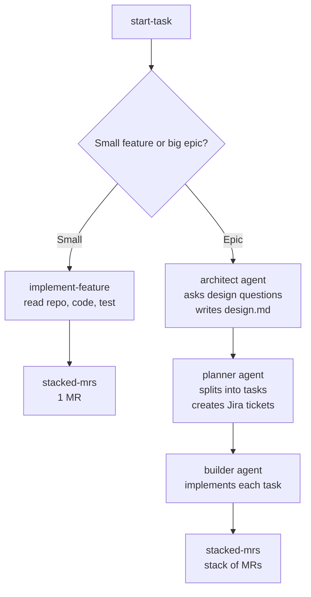

# agent-hub

One place for the team's shared AI **agents** and **skills**. Install them into any
repo with one command, and everyone works the same way.

## The idea in 30 seconds

```bash
apm install rutansh/agent-hub
```

Then tell your coding agent: **"use start-task"**. It asks whether your work is a small
feature or a big epic and does the rest.



## Agents (roles)

| Agent | Does one thing |
| --- | --- |
| `architect` | Interviews you about the design, then writes `design.md` |
| `planner` | Splits the design into small tasks and creates the Jira tickets |
| `builder` | Implements the tasks and opens a stack of merge requests |

## Skills (tasks)

| Skill | Does one thing |
| --- | --- |
| `start-task` | Entry point. Asks small vs epic, then routes the work |
| `implement-feature` | Builds a small feature using the repo's code as context |
| `jira-tickets` | Creates a Jira epic and child tickets |
| `stacked-mrs` | Ships work as a stack of small, dependent merge requests |

### Pharma skills (domain examples)

| Skill | Does one thing |
| --- | --- |
| `summarize-trial` | Turns a clinical trial record into a structured brief |
| `triage-adverse-events` | Prioritizes adverse event reports |
| `review-literature` | Synthesizes provided papers into a cited brief |

## Install

```bash
brew install apm                         # once per machine
gh auth login                            # this repo is private

apm install rutansh/agent-hub            # everything
apm install rutansh/agent-hub#v0.2.0     # pinned to a release

# only some skills (agents always come with it)
apm install rutansh/agent-hub --skill start-task --skill implement-feature
```

Files land in `.cursor/agents/` and `.agents/skills/`. For other tools, add a target,
for example `--target claude` or `--target copilot`.

Upgrade: change the ref in `apm.yml`, then `apm install --update`.

## Needed for the epic workflow

| Tool | Used for | Setup |
| --- | --- | --- |
| `glab` | Stacked MRs on GitLab | `brew install glab && glab auth login` |
| `gh` | Chained PRs on GitHub | `brew install gh && gh auth login` |
| `acli` | Creating Jira tickets | Install Atlassian CLI, then `acli jira auth login --web` |

If a tool is missing, the agents say so and use a fallback (for example writing tickets
to a markdown file) instead of failing silently.

## Contribute

See [CONTRIBUTING.md](./CONTRIBUTING.md). Add a file under `.apm/`, run
`./scripts/validate.sh`, open a PR.

## Layout

```
agent-hub/
  apm.yml
  .apm/
    agents/   architect, planner, builder
    skills/   start-task, implement-feature, jira-tickets, stacked-mrs, + pharma skills
  scripts/validate.sh
  .github/workflows/validate.yml
```
